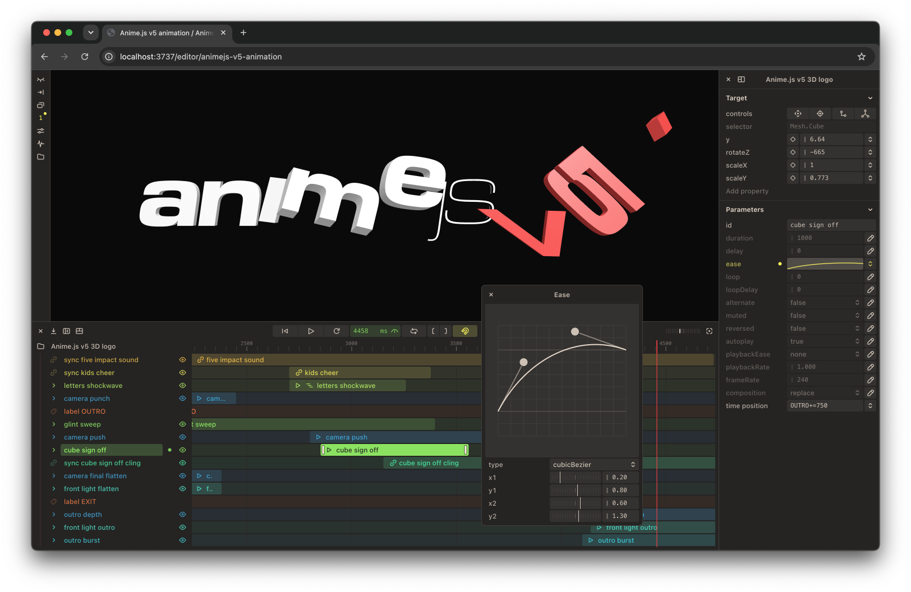

# Anime.js

<p align="center">
  
</p>

<p align="center">
  <strong>
  <em>Anime.js</em> is a fast, versatile and lightweight animation engine for the web, with a simple yet powerful API and a visual editor.<br>
  It works with CSS, SVG, HTML, WebGL, WebGPU and Canvas2D objects.
  </strong>
</p>


<p align="center">
  
  
  
</p>

## Sponsors

Anime.js is 100% free and is only made possible with the help of our sponsors.
Help the project become sustainable by sponsoring us on <a target="_blank" href="https://github.com/sponsors/juliangarnier">GitHub Sponsors</a>.

### Platinum sponsors

<table>
  <tbody>
    <tr>
      <td>
        <a target="_blank" href="https://github.com/sponsors/juliangarnier">
          <picture>
            
          </picture>
        </a>
      </td>
      <td>
        <a target="_blank" href="https://github.com/sponsors/juliangarnier">
          <picture>
            
          </picture>
        </a>
      </td>
      <td>
        <a target="_blank" href="https://github.com/sponsors/juliangarnier">
          <picture>
            
          </picture>
        </a>
      </td>
    </tr>
  </tbody>
</table>

### Silver sponsors

<table>
  <tbody>
    <tr>
      <td>
        <a target="_blank" href="https://www.testmuai.com/?utm_medium=sponsor&utm_source=animejs">
          <picture>
            <source media="(prefers-color-scheme: dark)" srcset="./assets/sponsors/testmu-ai-logomark.png?v=200126">
            
          </picture>
        </a>
      </td>
      <td>
        <a target="_blank" href="https://github.com/sponsors/juliangarnier">
          <picture>
            
          </picture>
        </a>
      </td>
      <td>
        <a target="_blank" href="https://github.com/sponsors/juliangarnier">
          <picture>
            
          </picture>
        </a>
      </td>
      <td>
        <a target="_blank" href="https://github.com/sponsors/juliangarnier">
          <picture>
            
          </picture>
        </a>
      </td>
      <td>
        <a target="_blank" href="https://github.com/sponsors/juliangarnier">
          <picture>
            
          </picture>
        </a>
      </td>
      <td>
        <a target="_blank" href="https://github.com/sponsors/juliangarnier">
          <picture>
            
          </picture>
        </a>
      </td>
    </tr>
  </tbody>
</table>

Get featured here by becoming a <a target="_blank" href="https://github.com/sponsors/juliangarnier">GitHub Sponsor</a>.


## Usage

Anime.js works by importing ES modules like so:


<table>
<tr>
  <td>

```javascript
import {
  animate,
  stagger,
} from 'animejs';

animate('.square', {
  x: 320,
  rotate: { from: -180 },
  duration: 1250,
  delay: stagger(65, { from: 'center' }),
  ease: 'inOutQuint',
  loop: true,
  alternate: true
});
```

  </td>
  <td>
    
  </td>
</tr>
</table>

## Documentation

The full documentation is available [here](https://animejs.com/documentation).

## Migration guides

Coming from V4, the breaking changes are listed in the V5 [release notes](https://github.com/juliangarnier/anime/releases).
Coming from V3, follow the v3 to v4 migration guide [here](https://github.com/juliangarnier/anime/wiki/Migrating-from-v3-to-v4) first.

## NPM development scripts

First, run `npm i` to install all the necessary packages.
Then, execute the following scripts with `npm run <script>`.

| script | action |
| ------ | ------ |
| `dev` | Watches for changes in `src/**/*.js`, builds the ESM and CJS modules to `dist/modules/` and creates type declarations next to them |
| `dev:test` | Runs `dev` and `test:browser` concurrently |
| `build` | Builds the ESM and CJS modules to `dist/modules/`, the ESM and UMD bundles to `dist/bundles/`, and creates type declarations in `dist/modules/` |
| `test` | Builds, then runs the type checks, the Node and browser test suites, and a browser performance comparison |
| `test:browser` | Starts a local server and runs all browser-related tests |
| `test:headless` | Runs the browser test suite in headless Chrome and reports pass / fail |
| `test:node` | Starts Node-related tests |
| `typecheck` | Checks the types of the source, the tests and the examples |
| `open:examples` | Starts a local server to browse the examples locally |

© [Julian Garnier](http://juliangarnier.com) | [MIT License](LICENSE.md)
